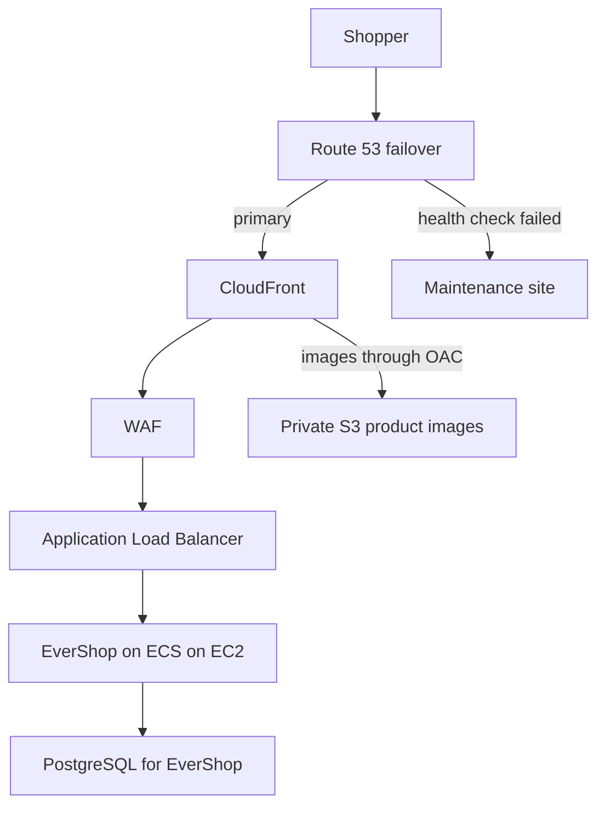
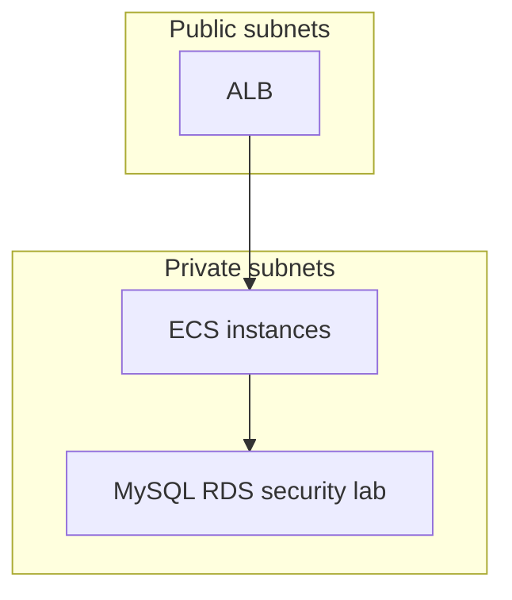
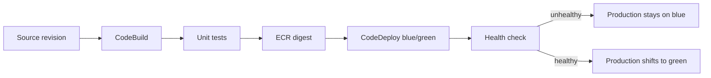

# CloudCart architecture

Status: DOCUMENTED. The diagrams describe the intended AWS design. The resources in the diagrams have not been created.

EverShop remains the store and uses PostgreSQL. The MySQL instance in Task 2 is a separate security demonstration.

## High-level request path

## Network

The private route table has no route to an internet gateway. A NAT gateway is not in the default configuration because it bills by the hour. Private instances reach S3 through a gateway endpoint, which has no hourly charge. They cannot pull from ECR until a NAT gateway or interface endpoints are approved.

The EverShop PostgreSQL container is local Docker, not this VPC.

## Security

- Shoppers are redirected to HTTPS. HSTS is sent with a five-minute max-age and without preload.
- One WAF web ACL is scoped to CloudFront and must live with the us-east-1 certificate. Another is scoped to the ALB in ap-south-1.
- The image bucket blocks public access, enforces bucket-owner ownership, encrypts with SSE-S3, and allows CloudFront reads only when the source distribution matches.
- The ECS execution role can pull images and write logs. The task role can read the store secret and the image bucket. The MySQL IAM login is a third principal, `cloudcart_iam`, and it is not the rotated password user.
- MySQL connections require TLS through `require_secure_transport`.

## Deployment

The local model of that shift is tested. CodeDeploy itself has not run.

## Data flow for an image

1. The API returns a presigned PUT that expires in 120 seconds. The signature is created locally in tests.
2. The object lands in `incoming/`.
3. The scanner classifies it. The EICAR test string goes to `quarantine/`. An EICAR miss goes to `holding/` and is not published. A WebP thumbnail is written beside that holding object. Only a verdict of `approved` may enter `public/`, and this scanner never emits that verdict.
4. CloudFront reads `public/` with Origin Access Control.
5. Lambda@Edge may convert a small image to WebP. A body at or above 1 MB is left unchanged because origin-response cannot return a larger generated body.

## Regions

Workload resources are in `ap-south-1`. The CloudFront certificate, the CloudFront WAF web ACL, and any Lambda@Edge function are in `us-east-1`.
