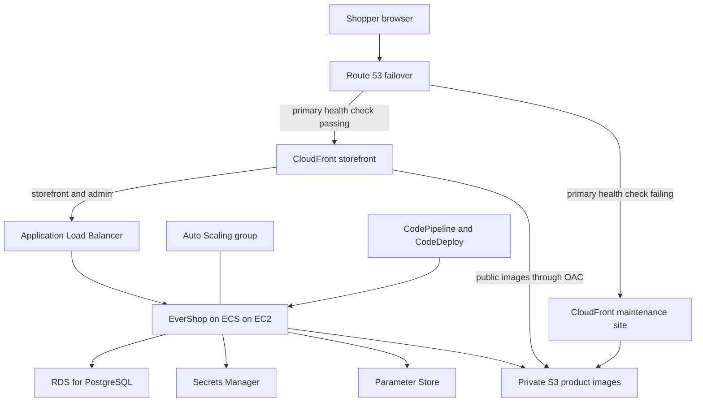

# CloudCart architecture

Status: design only. No AWS resource from this diagram exists.  
Reviewed: 17 November 2026 (Asia/Calcutta).

EverShop remains the application. The six internship tasks are parts of one store, not six separate labs.

## Request path

## Regions

| Concern | Region | Why |
| --- | --- | --- |
| VPC, subnets, NAT or endpoints, ALB, ECS, Auto Scaling, RDS, S3, regional ACM, regional WAF | `ap-south-1` | Mumbai. Lowest latency from Bengaluru among the commercial regions we would use. |
| ACM certificate for CloudFront, CloudFront-scope WAF, Lambda@Edge | `us-east-1` | AWS requires these in Northern Virginia. |
| Route 53, IAM, CloudFront distribution | Global | They are not regional services. |

## Task placement

**Task 1 — front door.** Route 53 hosts the domain. Two ACM certificates exist for the same names: one in `us-east-1` for CloudFront, one in `ap-south-1` for the ALB. Both are DNS-validated. Shoppers use HTTPS. A CloudFront response-headers policy sends HSTS. During early tests the `max-age` stays short, and the domain is not submitted to the preload list.

One CloudFront distribution owns the apex alias. Its origin group tries the ALB first and, on HTTP 500–504, reads the private maintenance page. A second distribution cannot use the same alias, so Route 53 primary and secondary records both alias this distribution. The health check does not claim that a second hostname has been proven. Alias queries to CloudFront are not billed as Route 53 queries. The hosted zone has a monthly charge unless it is deleted within 12 hours.

WAF needs two web ACLs. The CloudFront-scope ACL is created in `us-east-1`. The regional ACL is created in `ap-south-1` and is associated with the ALB only when that ARN is supplied. Each ACL includes the AWS common rule group and one IP rate rule. `SizeRestrictions_BODY` is counted rather than blocked so a normal store POST is not cut off at 8 KB.

**Task 2 — database security lab.** EverShop stays on PostgreSQL. The Task 2 stack is the MySQL 8 lab the brief asks for, in its own VPC, and it is not the store database. It is private, Multi-AZ, and not publicly accessible. The DB subnet group uses two private subnets in two Availability Zones.

Two logins, on two different users:

- `cloudcart_admin` has a password that RDS stores and rotates in Secrets Manager.
- `cloudcart_iam` uses the AWS authentication plugin and a 15-minute token. The client role may call `rds-db:connect` only for that user.

TLS is required with `require_secure_transport=1` and `tls_version=TLSv1.2,TLSv1.3`. The client checks the Amazon RDS certificate.

Backups use the automated backup window and a retention period inside 1–35 days. RDS uploads transaction logs about every five minutes. The recovery point objective of five minutes is demonstrated with `LatestRestorableTime`, which should stay within about five minutes of the current time. Restoring creates a new instance and takes longer than five minutes. That duration is recovery time, and the brief does not set a five-minute recovery time. The restored instance is deleted after the evidence is captured, because it bills on its own.

**Task 3 — capacity.** The ECS container instances run in an Auto Scaling group across at least two private subnets. One On-Demand host is the base. Capacity above that is Spot, across x86 types with at least 2 GiB. A launch hook holds the instance in `Pending:Wait` and abandons it unless the schema version matches. A termination hook drains tasks and then continues. Instance health is EC2. Task health is the load balancer target group. Migrations run once from the pipeline, under a lock, so two new instances cannot alter the schema at the same time.

Scaling policies use ALB request count per target and CPU utilization. The chaos tests are controlled: terminate an instance under a recorded load, and remove capacity from one Availability Zone. Continuity means the load balancer keeps returning success for the storefront while a healthy instance remains. The test log will include timestamps. An Availability Zone cannot be physically powered off from a student account; the test removes that zone's instances and records that limit.

**Task 4 — how a release ships.** A production Dockerfile builds EverShop. The development Compose file remains the local file and is not the production task definition. Images go to a private ECR repository. ECS on EC2 runs the tasks behind the ALB. Non-secret configuration is in Parameter Store. CodeBuild builds the image. CodePipeline deploys it.

Blue/green means CodeDeploy, two target groups, a test listener, a traffic shift, and a tested rollback to the previous revision. A rolling ECS deployment will not be labeled blue/green.

Product media cannot live on the container disk once more than one task runs. Media goes to the Task 6 bucket before scale-out is treated as a real test.

**Task 5 — a separate image distribution.** Product images use their own CloudFront distribution and a hostname that starts with `images.`. The Task 1 apex distribution is not reused and its alias is rejected here. Origin Access Control signs requests to the private Task 6 bucket. The viewer-request function allows a versioned product path and rewrites it to `public/products/...`. The cache key is that path. Cookies, authorization, and query strings are not part of it. WebP conversion is not attached: the edge package has no encoder, and a new rendition is a new object version instead. Lambda@Edge versions are published in `us-east-1`. No function has been published.

**Task 6 — the bucket itself.** The product-image bucket is private, Block Public Access is on, and Object Ownership is bucket owner enforced. Default encryption is on. Presigned PUT and GET are generated by a role, used once in a test, and shown to expire. CloudFront, not a public bucket policy, is the public read path.

Lifecycle configuration covers Intelligent-Tiering and a transition toward an S3 Glacier storage class. The standalone Glacier vault service is not used. Minimum storage duration is explained before the rule is applied.

S3 Inventory writes a report to a second private bucket. New uploads invoke a scan function. The practical implementation is a Lambda container image with ClamAV, because the signature database does not fit a small zip deployment. Objects stay out of the public prefix until the scan marks them clean. Infected objects move to a quarantine prefix.

S3 Object Lambda is the on-demand thumbnail mechanism if the account is still allowed to use it. Decision D-002 covers the feasibility assessment when it is not.

## Network

Public subnets hold the ALB and, if approved, NAT gateways. Private subnets hold ECS instances and RDS. The database security group accepts PostgreSQL only from the application security group, on TCP 5432.

A NAT gateway has an hourly charge and a data-processing charge in every Availability Zone where it runs. A gateway VPC endpoint for S3 has no hourly charge and removes S3 traffic from the NAT path. Interface VPC endpoints have an hourly charge. The cheaper private-subnet design uses gateway endpoints for S3 and ECR-related traffic is decided when the network step is approved. Public subnets for the application instances would be cheaper and would fail the private-subnet requirement, so they are not the design.

## What has to exist before something else works

1. Non-root identity and a spend ceiling.
2. A domain you control, or a decision to defer Task 1 until the origin works over an AWS name.
3. Shared image storage (Task 6) before more than one EverShop task (Tasks 3 and 4).
4. The database (Task 2) before ECS can serve the store (Task 4).
5. The ALB and ECS service (Task 4) before Auto Scaling evidence (Task 3) and before Route 53 points at a real origin (Task 1).
6. CloudFront in front of that origin (Tasks 1 and 5) before WAF-on-CloudFront, HSTS at the edge, and failover can be tested.

## Security sketch

- Security groups are allow-lists. The database has no route from the internet.
- IAM roles are attached to EC2, ECS tasks, CodeBuild, and Lambda. Access keys are not written into task definitions.
- Public S3 access is blocked. CloudFront OAC is the reader for public images.
- WAF managed rules sit on the Task 1 distribution, in both CloudFront and regional scopes. The image distribution does not attach a second web ACL.
- Encryption in transit for shoppers (ACM) and for the database (`rds.force_ssl`). Encryption at rest for RDS and S3.
- Deployment is immutable: a new image digest, not a changed container.
