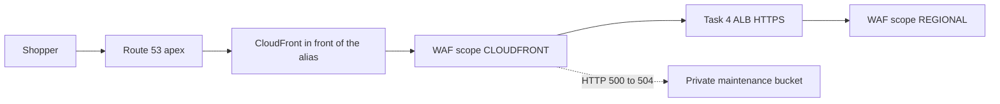

# Task 1 — Route 53, ACM, HTTPS, and WAF

Status: **TERRAFORM VALIDATED. Not deployed.** `confirm_paid_deployment` defaults to false, so a plan adds nothing. No zone, certificate, distribution, or web ACL exists. A domain is not registered by this stack.

## Architecture



The shopper resolves the domain you already control. Route 53 aliases that name to one CloudFront distribution. The distribution redirects HTTP to HTTPS, uses the `us-east-1` certificate, sends HSTS, and applies the CloudFront web ACL. The first origin is the Task 4 load balancer over TLS 1.2. If that origin returns 500, 502, 503, or 504, CloudFront fetches the same path from the private S3 maintenance origin. The page that is known to exist there is `/index.html`. A deep link can still return 403 from S3 during that failover. That limitation is not hidden.

The origin request policy forwards cookies, query strings, and a short header list. It does not forward `Host` or `Authorization`. Forwarding either header makes the S3 origin reject the signed failover request. The app therefore sees the load balancer name as `Host`. Set the store's public URL to the apex when the container is configured. The cache policy is the AWS managed `CachingDisabled` policy (`4135ea2d-6df8-44a3-9df3-4b5a84be39ad`) so one shopper's response is not stored for the next.

The regional certificate is requested in `ap-south-1`. It is attached only when `alb_https_listener_arn` is set. Task 4 can also create the HTTPS listener when `alb_certificate_arn` is set to this certificate. This stack does not create a second load balancer.

## Why the certificate regions differ

CloudFront accepts only an issued public certificate from `us-east-1`. The ALB listener accepts only a certificate in `ap-south-1`. The same names are requested in both regions. Both use DNS validation records in the Route 53 zone. `aws_acm_certificate_validation` waits for `ISSUED` before the distribution reads the certificate ARN. ACM renews a DNS-validated public certificate while the validation record remains. A wildcard covers one label, such as `maintenance.example.com`. It does not cover the apex; the apex is the certificate's primary name.

This stack does not call Route 53 Domains and does not buy a name. After the zone exists, the registrar's name servers must be changed to the four name servers in the `name_servers` output. Until that delegation is in place, ACM stays pending and nothing on the internet uses this zone.

## DNS and failover

| Record | Type | Target |
| --- | --- | --- |
| Apex primary | A and AAAA | This distribution. Health check is HTTPS `/` on the distribution domain, every 30 seconds, three failures. |
| Apex secondary | A and AAAA | The same distribution. |

`evaluate_target_health` is false. CloudFront does not publish target health to Route 53, and setting it true can mark a healthy alias unhealthy.

Both records use the same target because a second CloudFront distribution cannot hold the same alternate domain name. Pointing the apex at a second `*.cloudfront.net` name would make the browser send the apex in SNI while the second distribution presents a different certificate. Maintenance content is the origin group, not a second public name. A live DNS cutover has not been measured.

CloudFront hosted zone id `Z2FDTNDATAQYW2` is Amazon's published id for CloudFront alias records.

## HTTPS and HSTS

Viewers are redirected to HTTPS. The minimum viewer protocol is `TLSv1.2_2021`. The ALB listener, when Task 4 creates it, uses `ELBSecurityPolicy-TLS13-1-2-2021-06`. CloudFront talks to the ALB with HTTPS only and TLS 1.2. HSTS max-age is 300 seconds, includes subdomains, and does not include `preload`. A longer max-age is rejected by variable validation. Do not submit the domain to the preload list during this project.

## WAF

| Web ACL | Scope | Region | Rules |
| --- | --- | --- | --- |
| `cloudcart-cloudfront` | `CLOUDFRONT` | `us-east-1` | IP rate limit, then `AWSManagedRulesCommonRuleSet` |
| `cloudcart-alb` | `REGIONAL` | `ap-south-1` | The same two rules |

The rate rule blocks one IP after 2,000 requests in five minutes. A shop, a campus NAT, or a health checker can trip that limit. Raise `waf_rate_limit` if a test shows a false block. `SizeRestrictions_BODY` is set to count because the common rule group inspects 8 KB and a store POST is larger. The other common rules stay in block mode. Metrics and sampled requests are on. A full WAF log destination is not created; that logging has its own charge and is not required to prove the rules exist.

There is no IP allow list. The store is public. Geo blocking is off.

The regional web ACL is associated only when `alb_arn` is set. Direct requests that reach the load balancer would skip the CloudFront ACL, so Task 4 admits ports 80 and 443 only from the CloudFront origin-facing prefix list `com.amazonaws.global.cloudfront.origin-facing`. That list is read during an approved apply. It is not read during local validation. A large prefix list can exceed the security-group rule quota; that is a deployment check, not a local failure. Viewer IPv6 stops at CloudFront. The origin connection is expected to use the addresses in that list.

## Maintenance bucket

The bucket name is derived from the domain with dots replaced, so it is a legal S3 name. Public access is blocked, the bucket owner is enforced, and encryption is AES256. The policy denies non-TLS requests and allows `s3:GetObject` only to `cloudfront.amazonaws.com` when the source ARN is this distribution. The bucket is not a website endpoint.

## Deployment prerequisites

1. A domain you already control. Do not use `example.invalid`.
2. `confirm_paid_deployment = true` for this stack only, with a named rupee ceiling.
3. `local_validate_credentials = false` and a non-root IAM identity.
4. `alb_dns_name` from Task 4, and an HTTPS listener on that load balancer. CloudFront uses `https-only`. The Task 4 HTTP listener redirects to 443, so an HTTP origin would loop.
5. After apply, delegate the registrar to `name_servers` and wait until both certificates are `ISSUED`.
6. Pass `alb_certificate_arn` into Task 4, or set `alb_https_listener_arn` here.

## Validation commands

From the repository root, with no AWS credentials required:

```powershell
terraform -chdir=infrastructure/terraform/task-1-route53-acm-waf fmt -check
terraform -chdir=infrastructure/terraform/task-1-route53-acm-waf init -backend=false -input=false
terraform -chdir=infrastructure/terraform/task-1-route53-acm-waf validate
terraform -chdir=infrastructure/terraform/task-1-route53-acm-waf plan -input=false -lock=false
python -m unittest tests.infrastructure.test_terraform_contracts tests.unit.test_deploy_and_edge_contracts
```

A plan exit code of 0 means no resources change while the paid gate is false. It is not an applied stack. `tfsec` and `checkov` are not installed here, so no static-analysis tool was run against this stack.

## Cost

These are published list prices, not a bill for this account. USD. GST is extra. Nothing here has been created.

| Item | Assumption | If it is left running |
| --- | --- | --- |
| Domain registration | Not performed | A `.com` is commonly about $14 for a year and is usually not refundable |
| Public hosted zone | First 25 zones | $0.50 per month, charged at creation. Deleted within 12 hours: no zone charge. Queries still bill. |
| DNS queries | Alias to CloudFront | Alias queries to CloudFront are not charged as Route 53 queries |
| ACM public certificate | DNS validation, two regions | $0. Private CA is not used. |
| HTTPS health check | CloudFront in this account is an AWS endpoint | Basic checks for the first 50 AWS endpoints are not charged. The HTTPS option is about $1 per month on an AWS endpoint. |
| CloudFront | `PriceClass_200`, so Asia is included | Data transfer and HTTPS requests. No flat monthly fee. Confirm the current rate before a test. |
| WAF | Two web ACLs, each with a managed group and one rate rule | About $5 per web ACL and $1 per rule or managed group, prorated hourly. About $14 per month before requests, plus $0.60 per million inspected requests per web ACL. Requests that pass CloudFront and then the ALB can be inspected twice. |
| S3 maintenance object | One small HTML file | Negligible at Standard rates |
| WAF full logs | Not enabled | The included sample and metric views are used instead |

A six-hour window is roughly the hourly share of the zone, the health-check option, and the two web ACLs: on the order of a few US dollars, plus any domain fee and CloudFront traffic. Delete the web ACLs, the health check, and the distribution when the window ends. Delete the hosted zone within 12 hours if the only goal is to avoid the $0.50 charge. AWS Budgets does not stop these charges.

## Security choices that stay open until a domain and an account exist

DNSSEC is not enabled. It needs a working delegation and a key-signing key, and a mistaken DS record takes the name offline. Query logging is not enabled. It writes to CloudWatch Logs and adds cost. WAF request logging to S3 or Firehose is not enabled for the same reason. Sampled requests and CloudWatch metrics are the visibility that exists in this configuration. `SizeRestrictions_BODY` counts instead of blocking, so an oversized body is visible and is not stopped by that one rule. The header whitelist can omit a header EverShop later requires. Add it in the origin request policy. Do not add `Host` or `Authorization`. No live certificate, DNS answer, TLS handshake, or WAF block has been observed.

## Rollback

Revert the apex records to the previous alias, or set `confirm_paid_deployment` back to false only in a copy of the state you intend to destroy. Disassociate the regional web ACL by clearing `alb_arn`. Do not delete the hosted zone until the registrar no longer delegates to it. `create_before_destroy` on the certificates avoids a gap during a name change. There is no `prevent_destroy` on the distribution or the web ACLs, because those are the resources that must be deletable to stop the hourly WAF charge.

## Evidence

| Check | State |
| --- | --- |
| Terraform fmt, validate, and a zero-change plan | Recorded by the local validation run after this change |
| HSTS and redirect rules in `cloudcart/deploy.py` | Local unit test. Not a live response. |
| Configuration contains both regions, both WAF scopes, origin failover, and no domain registration | Local contract test |
| Issued certificate, delegated zone, HTTPS response, WAF sample, measured failover | **Not verified.** No AWS resource was created. |

The boxes in `evidence/task-1-route53-acm-waf/README.md` stay open. Do not treat this page as a console capture.
