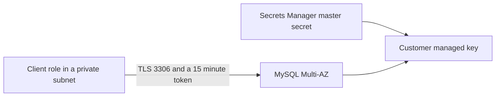

# Task 2 — Private MySQL, IAM authentication, rotation, and recovery

Status: **TERRAFORM VALIDATED. Not deployed.** `confirm_paid_deployment` defaults to false, so a plan adds nothing. No VPC, database, key, secret, or function exists. EverShop stays on PostgreSQL. This stack is the MySQL security lab and is not the store database.

## Architecture



The lab VPC is `10.20.0.0/16`. Two subnets, `10.20.10.0/24` and `10.20.11.0/24`, sit in `ap-south-1a` and `ap-south-1b`. Their route table has an S3 gateway endpoint and no internet route. `map_public_ip_on_launch` is false. There is no NAT gateway.

The database subnet group uses only those subnets. `publicly_accessible` is false. The database security group allows TCP 3306 from the application security group and from nowhere else. The application security group has no ingress, so there is no SSH from the internet. Its egress is MySQL to the database security group, DNS to the VPC resolver, HTTPS to the S3 prefix list, and HTTPS to the interface endpoints when those are enabled.

Task 4 does not use this VPC. The store's PostgreSQL path stays on port 5432 and is selected only when `database_security_group_id` is set there. Do not point EverShop at this MySQL instance.

## RDS configuration

| Setting | Value |
| --- | --- |
| Engine | MySQL 8.0, minor upgrades left to RDS |
| Class | `db.t3.micro` by default |
| Deployment | Multi-AZ, one standby |
| Storage | gp3, 20 GiB, autoscaling ceiling 100 GiB |
| Encryption | Customer managed key, rotation enabled |
| Public access | false |
| IAM authentication | enabled |
| TLS | `require_secure_transport=1`, `tls_version=TLSv1.2,TLSv1.3` |
| `local_infile` | 0 |
| Audit | MariaDB audit plugin: CONNECT, QUERY_DDL, QUERY_DCL |
| Logs | audit, error, slowquery |
| Backups | 7 days, window 18:30–19:00 UTC |
| Deletion | protection on, `prevent_destroy`, final snapshot required |
| Apply | `apply_immediately` is false |

Full query text is not sent to the audit log. A lab that logs every statement copies application data into CloudWatch.

## Two logins

These users are not interchangeable.

`cloudcart_iam` is created from `application/database/mysql-lab/rds-iam-user.sql` after the instance exists. The plugin is `AWSAuthenticationPlugin`. The user has no password. The client role may call `rds-db:connect` only on `arn:aws:rds-db:ap-south-1:ACCOUNT:dbuser:RESOURCE_ID/cloudcart_iam`. The account and resource id are filled from the instance at apply time. The reviewed template is `security/iam/rds-connect-policy.json`.

The token is signed on the instance from the instance-role credentials. The signature host is `rds.ap-south-1.amazonaws.com`. RDS does not return the token, and the call does not go to STS. The token lasts 15 minutes. The client must open a new one at least a minute before that, over TLS, and must check the Amazon RDS certificate. `cloudcart/db.py` records that plan and a fake token shape. It does not sign a real token.

`cloudcart_admin` is the master user. RDS creates its password in Secrets Manager and rotates that secret on the RDS schedule, which defaults to 7 days. Terraform does not set a password and does not store one. A rotation Lambda is not attached, because a second rotator would fight the RDS-managed rotation. The instance profile cannot read that secret. An operator retrieves it with a separate admin role when a break-glass login is required. The application does not use the master password.

If rotation fails, Secrets Manager leaves `AWSCURRENT` on the previous version. The EventBridge rule `cloudcart-mysql-rotation-failed` writes `RotationFailed` into `/cloudcart/mysql/rotation`. The local simulation discards `AWSPENDING` and puts the database password back to `AWSCURRENT`. That simulation is not an RDS rotation.

## Administration

Port 22 is not opened. This stack does not create an EC2 instance. It creates the instance profile a private instance would use. Session Manager would also need the Systems Manager endpoints, which are a separate hourly charge and are not in this stack. Do not add a bastion to reach the database.

## Backup and recovery

`backup_retention_days` must be from 1 to 35. A value of 0 is rejected because it turns off point-in-time recovery. Automated backups plus transaction logs are what RDS uses for point-in-time restore. RDS uploads those logs about every five minutes, so a five-minute recovery point is the target. It is not a measured `LatestRestorableTime`. A passing local calculation does not restore an instance.

A restore creates a new instance. That work is recovery time, and it is longer than five minutes. The original instance stays. The new instance bills until it is deleted. No restore has been run.

Alarms exist for CPU above 80 percent, free storage below 2 GiB, and more than 40 connections. No email or SMS topic is attached.

## Deployment prerequisites

1. `confirm_paid_deployment = true` for this stack only, with a named rupee ceiling.
2. `local_validate_credentials = false` and a non-root identity that can create the database, the key grant, and the client role.
3. After apply, run `rds-iam-user.sql` on this instance only.
4. Delegate nothing in DNS. This stack has no domain.

## Validation commands

```powershell
terraform -chdir=infrastructure/terraform/task-2-secure-rds fmt -check
terraform -chdir=infrastructure/terraform/task-2-secure-rds init -backend=false -input=false
terraform -chdir=infrastructure/terraform/task-2-secure-rds validate
terraform -chdir=infrastructure/terraform/task-2-secure-rds plan -input=false -lock=false
terraform -chdir=infrastructure/terraform/task-2-secure-rds plan -input=false -lock=false -var=backup_retention_days=0
python -m unittest tests.infrastructure.test_terraform_contracts tests.unit.test_database_security tests.security.test_policies_and_secrets
```

The zero-retention plan must fail. A plan exit code of 0 with the defaults means no resources change. It is not an applied database. `tfsec` and `checkov` are not installed here.

## Cost

These are planning figures, not a bill. USD, before GST. The instance price is a secondary listing for RDS MySQL `db.t3.micro` in `ap-south-1`, updated 19 October 2026: about $0.025 per hour Single-AZ and $0.049 per hour Multi-AZ. Confirm it on the Amazon RDS for MySQL pricing page before any apply. A 730-hour month at $0.049 is about $36 for compute.

| Item | Assumption |
| --- | --- |
| Multi-AZ instance | About $0.049 per hour. One standby, not two readable standbys. |
| gp3 storage | 20 GiB to start, ceiling 100 GiB. Multi-AZ stores a second copy. Read the Mumbai gp3 row before apply. This note does not invent a per-GiB rate. gp3 baseline I/O is included. |
| Backup storage | Backup storage up to the provisioned size is not charged. Extra snapshots and a long retention window are. |
| Secrets Manager | One RDS-managed secret, $0.40 per secret-month, prorated hourly, plus $0.05 per 10,000 API calls. |
| Customer managed key | $1 per month, prorated hourly. Automatic rotation can add $1 per month for the first and second rotation. Requests above 20,000 per month are extra. |
| Interface endpoints | About $0.01 per endpoint ENI-hour. Two endpoints in two zones is about $0.04 per hour, about $29 in a 730-hour month, plus data. |
| Alarms and logs | A few CloudWatch alarms and a 14-day rotation log. Quiet while the database is idle. Audit and slow-query logs grow with traffic. |
| EC2 | This stack does not create an instance. |

A month left running is on the order of $70 before storage, logs, data, and GST. AWS Budgets does not stop it. A short window still bills instance seconds, with a 10-minute minimum after a billable change, and endpoint hours until the endpoints are deleted.

## Rollback

`deletion_protection` and `prevent_destroy` block an accidental destroy. Removing them is a separate reviewed change. Take a snapshot first. Deleting the instance can leave a final snapshot named `cloudcart-mysql-final`. Automated backups are deleted with the instance so they do not keep billing. The customer managed key cannot be deleted while the instance uses it. After the instance is gone, schedule the key for deletion. A key that is scheduled for deletion is not charged. A secret scheduled for deletion is not charged.

To undo a bad password rotation, read `AWSCURRENT` and do not delete the instance. The previous version remains until a later rotation replaces `AWSPREVIOUS`.

## Evidence

| Class | Result |
| --- | --- |
| Implemented in code | Private Multi-AZ MySQL, TLS parameters, IAM connect policy, RDS-managed secret, key, alarms, rotation-failure rule, backup retention. |
| Validated locally | fmt, init, validate, a zero-change plan, a rejected zero-retention plan, and the unit tests. |
| Confirmed by AWS | Nothing. |
| Not yet verified | A live endpoint, an IAM login, a rejected non-TLS login, a rotated secret version, `LatestRestorableTime`, and a restore. |

The boxes in `evidence/task-2-secure-rds/README.md` stay open.
