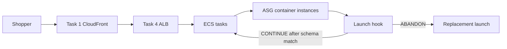

# Task 3 — Auto Scaling, mixed instances, and failure handling

Status: **TERRAFORM VALIDATED. Not deployed.** `confirm_paid_deployment` defaults to false, so a plan adds nothing. No Auto Scaling group, launch template, or instance exists. The chaos tests are a local model. They do not terminate EC2 instances.

## Architecture



Task 1 sends shoppers to CloudFront. CloudFront uses HTTPS to the Task 4 load balancer. The load balancer sends traffic to ECS tasks, not to the instance itself. This group only supplies the EC2 hosts those tasks run on.

The group spans the private subnets you pass in. Two is the minimum, so one Availability Zone can be lost. There is no NAT gateway in this stack. The subnets must already be able to reach ECS, ECR, Systems Manager, CloudWatch, and Auto Scaling. Port 22 is not opened.

## Mixed capacity

| Setting | Default | Why |
| --- | --- | --- |
| Minimum | 2 | One host can remain when a zone or a Spot instance is lost. |
| Desired | 2 | Starts on the minimum. |
| Maximum | 4 | Caps a short test. A larger ceiling needs its own cost approval. |
| On-Demand base | 1 | The group is never entirely Spot. |
| On-Demand above base | 0% | Extra capacity is Spot. |
| Types | `t3.small`, `t3a.small`, `t3.medium` | x86, at least 2 GiB. |
| Spot strategy | `capacity-optimized` | Picks the pool with the most spare capacity. |
| Rebalance | on | Starts a replacement when Spot sends a rebalance recommendation. |

`t3.micro` is rejected. The Task 4 container asks for 1024 MiB, and the ECS agent needs memory of its own. Graviton types are rejected because the ECS-optimized AMI in this stack is x86. A desired capacity above the maximum is rejected before a plan can apply it.

With the defaults, one host is On-Demand and one is Spot. If Spot capacity is missing, the group can sit below desired until a pool is available. That shortage has not been observed, because nothing has launched.

## Scaling

Two target-tracking policies share a 300 second warm-up.

- CPU target: 60 percent, `ASGAverageCPUUtilization`. Scale-out when the average stays above the target. The policy's own alarms are created by Auto Scaling.
- Request target: 100 ALB requests per target. The label must be the live `app/load-balancer-id/target-group-id` value. The placeholder is rejected on an approved apply.
- Scale-out happens if either policy wants more capacity. Scale-in happens only when both want less. Desired capacity never passes the maximum, and scale-in in the local model will not go below the minimum or remove the last On-Demand host.
- A separate alarm watches `GroupInServiceInstances` below the minimum for three minutes. It has no email or SMS topic.

## Lifecycle

Launch hook `cloudcart-warmup` waits up to 600 seconds and defaults to `ABANDON`. The user-data script is idempotent: it rewrites `/etc/ecs/ecs.config`, enables Spot draining, reads `/cloudcart/production/schema_version`, and does not print that value. `CONTINUE` is sent only when the value matches the image. The ECS agent starts after that signal. A missing command, a failed read, or a mismatch sends `ABANDON` immediately and does not start the agent. The group then launches a replacement. A repeated failure is an operator problem: suspend launch or fix the template. Do not change the timeout result to `CONTINUE`.

This script does not migrate the database. The pipeline migrates once, under a lock. Two instances launching together must not both apply a schema change.

Termination hook `cloudcart-drain` waits 180 seconds and defaults to `CONTINUE`, so a dead host is not stuck in `Terminating:Wait`. The shutdown script marks the container instance `DRAINING` and then completes the hook. Spot interruption draining is also enabled in the ECS agent. Instance health checks are EC2. Task health stays on the Task 4 target group. Attaching that target group to this group would fight the ECS service, because the tasks use `awsvpc` addresses rather than the instance.

## Chaos model

`cloudcart/scaling.py` and `tests/chaos/test_chaos.py` simulate:

- A launch that is not warm, or whose schema does not match, is abandoned and cannot serve.
- A launch that is still pending at 600 seconds is abandoned.
- One zone can fail and the other can still serve. Both zones failing cannot.
- An unhealthy host and a five-second response do not serve.
- A Spot interruption drains that host. An On-Demand host is not treated as a Spot interruption.
- Scale-in removes a Spot host first, stops at the minimum, and keeps the On-Demand base.
- A scale-out host does not serve until its hook returns `CONTINUE`.

These results are labeled simulated. No Availability Zone was powered off and no instance was terminated.

## Security

The instance role may call `ssm:GetParameter` only for the schema parameter, and the lifecycle actions only on this group. Drain actions are limited to the `cloudcart` cluster, its container instances, and its tasks. The ECS agent also has the AWS-managed `AmazonEC2ContainerServiceforEC2Role` policy. That managed policy is what lets the agent register and pull images. It is broader than the inline policy, and it is the supported agent policy rather than a new wildcard written here.

IMDSv2 is required, with a hop limit of 1, so a container on the host cannot read the instance role. The root volume is encrypted gp3. The account's default EBS key is used, so this stack does not create another customer managed key. User data contains no credentials. Outputs are names and ids, not secrets.

The security group is an input. An approved apply rejects the placeholder `sg-00000000000000000`. Pass the Task 4 instance group, which has no public SSH. Do not replace the Task 1 CloudFront prefix list on the load balancer.

## Deployment prerequisites

1. `confirm_paid_deployment = true` for this stack only, with a named rupee ceiling.
2. `local_validate_credentials = false`.
3. The current x86 ECS-optimized AMI, two private subnets, the Task 4 security group, and the live ALB resource label.
4. The schema parameter already set by the pipeline. A missing parameter abandons the launch.
5. A network path to the AWS APIs. This stack does not add a NAT gateway.

## Validation commands

```powershell
terraform -chdir=infrastructure/terraform/task-3-autoscaling fmt -check
terraform -chdir=infrastructure/terraform/task-3-autoscaling init -backend=false -input=false
terraform -chdir=infrastructure/terraform/task-3-autoscaling validate
terraform -chdir=infrastructure/terraform/task-3-autoscaling plan -input=false -lock=false
terraform -chdir=infrastructure/terraform/task-3-autoscaling plan -input=false -lock=false -var=desired_capacity=9
python -m unittest tests.infrastructure.test_terraform_contracts tests.chaos.test_chaos
```

The desired-capacity plan must fail. A default plan that exits 0 changes nothing. `tfsec` and `checkov` are not installed here.

## Cost

Planning figures, not a bill. Confirm them on the EC2 pricing page before any apply. A secondary listing for `ap-south-1` shows `t3a.small` at about $0.012 per hour and `t3.medium` at about $0.045 per hour. The same listing shows Spot near $0.005 and $0.016. Spot prices move and are not a quote. `t3.small` in US East is $0.0208 per hour; Mumbai is not copied from that row.

| Item | Assumption |
| --- | --- |
| On-Demand host | One host at the base. A `t3.medium` hour is the expensive end of the allow-list. |
| Spot host | One host above the base. Discounted, and it can disappear. |
| EBS | 30 GiB gp3 per host, encrypted with the default EBS key. Delete-on-termination is set. |
| ALB | Not created here. Task 4 owns it. |
| Alarms | One alarm, about $0.10 per month if left in place. Group metrics themselves are not a separate charge. |
| Logs | The bootstrap log stays on the instance disk. |
| NAT | Not created. A NAT gateway would be about $0.045 per hour plus data. Do not add one to make this group launch. |
| Data transfer | Cross-zone traffic between the load balancer and the tasks is extra. |

Two hosts left running for a 730-hour month can be a few tens of dollars before the load balancer, data, and GST, and more if both land on `t3.medium`. A short window still bills instance seconds, with a one-minute minimum after a billable change. AWS Budgets does not stop it. Scale the group to zero and delete it when the window ends. The launch template uses a name prefix, so old versions can remain until the group is gone.

## Rollback

Set the desired capacity back to the minimum, or set `confirm_paid_deployment` only in a copy of state you intend to destroy. Suspend `Launch` before changing the template if new hosts are abandoning in a loop. Do not flip the launch hook to `CONTINUE` to hide a bad schema. The termination hook already continues after 180 seconds.

## Evidence

| Class | Result |
| --- | --- |
| Implemented in code | Mixed group, encrypted launch template, IMDSv2, both hooks, both scaling policies, instance role, drain script. |
| Locally tested | Capacity bounds, hook abandon and timeout, Spot interruption, scale-in floor, and an unready host. |
| Terraform validated | fmt, init, validate, a zero-change plan, and a rejected desired capacity of 9. |
| AWS verified | Nothing. |
| Not yet verified | A launch, a Spot notice, a measured scale-out, and a zone removal against a live load balancer. |
