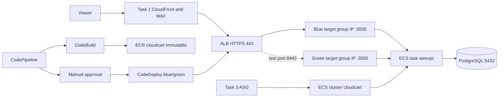

# Task 4 — ECS, ECR, and immutable delivery

Status: **implemented and checked locally. Not deployed.** Terraform for this stack formats, initializes with the backend disabled, validates, and plans with no changes while `confirm_paid_deployment` stays false. The image was **not built**. Docker is not installed in this environment, so every Docker build and container runtime check is **blocked**.

EverShop stays on PostgreSQL. Task 2 MySQL is a separate lab and is not the store database. The Compose volume `postgres-data` was not removed, reused, or migrated.

## Architecture



Traffic still enters through the Task 1 CloudFront distribution. The ALB allows ports 80, 443, and 8443 only from the CloudFront origin-facing prefix list. Port 80 redirects to HTTPS. Port 443 forwards to the blue target group. Port 8443 is the CodeDeploy test listener and forwards to green. Both target groups are `target_type = ip` on port 3000. They are not attached to the Auto Scaling group.

The ECS service uses `awsvpc`. Each task gets its own address in a private subnet and `assign_public_ip` is false. The load balancer registers that address. Registering the task against an instance target group would point health checks at the host, so this stack does not do that.

## Four health layers

| Layer | What it means here |
| --- | --- |
| EC2 host | Task 3 instance health stays `EC2`. A host can be InService while its tasks are failing. |
| ECS container instance | The host agent is connected to cluster `cloudcart` and has free CPU and memory. Task 3 starts the agent only after the schema check. |
| ECS task | The task is running and the container health check can reach `http://127.0.0.1:3000/`. |
| ALB target | The target group health check requests `/` and accepts 200–399. Only healthy targets receive traffic. |

Unhealthy tasks are replaced by the service. A failed CodeDeploy deployment rolls production traffic back and stops on timeout. The 120 second `health_check_grace_period_seconds` and the 60 second Docker start period give EverShop time to open port 3000 before it is marked failed. Deregistration delay is 30 seconds on both target groups.

## Container

`application/docker/Dockerfile` starts from the EverShop index digest recorded on 17 November 2026:

`evershop/evershop@sha256:385934128c115f0ea92df17f5d70998532208d4a94b9b6b28149af74b5b3f6b2`

The Dockerfile does not copy the repository. Media stays out of the image. Credentials, AWS keys, and `.env` are not build arguments. `NODE_ENV` is `production`. The process listens on port 3000. `STOPSIGNAL SIGTERM` is declared so ECS can ask the process to exit. OCI labels name the image and state that credentials are not inside it.

The upstream image is `node:18-alpine` and does not set `USER`. `/app` is root-owned, and EverShop writes files while it starts. `USER node` is therefore **not** set. The container still runs as root. That is an open finding, not a completed control. A non-root user can be added only after a real image build shows the process can write what it needs.

`HEALTHCHECK` requests `/` on `127.0.0.1:3000` and accepts status 200–399. It has not been executed here.

The root `.dockerignore` is the file Docker reads for `docker build -f application/docker/Dockerfile .`. It excludes `.env`, keys, Terraform state, `.terraform`, and `evidence`. `docker-compose.yml` remains the local development file. It keeps the named volume `postgres-data` and publishes the store only on `127.0.0.1:3000`. Do not run `docker compose down -v` against that project.

### Build command, not yet run

From the repository root, when Docker is available:

```bash
docker build --pull -f application/docker/Dockerfile -t cloudcart-evershop:local .
```

That command does not start a container and does not attach `postgres-data`. The local tag is for inspection only. Production does not deploy a mutable tag.

## ECR

Repository name: `cloudcart`. It is private. Tag mutability is `IMMUTABLE`, so a pipeline cannot overwrite an existing tag. Encryption is AES256. Basic scanning runs on push. `prevent_destroy` is set. A repository policy allows the execution role and the CodeBuild role to pull and push. There is no `Principal: "*"`.

`ecr:GetAuthorizationToken` cannot be scoped to one repository. It is the only `Resource: "*"` statement on the execution role. Authentication uses the CodeBuild role or the execution role. No access key is stored in the repository.

### Naming and rollback selection

| Identifier | Use |
| --- | --- |
| Git commit SHA | Immutable ECR tag, from `CODEBUILD_RESOLVED_SOURCE_VERSION`. |
| Image digest `@sha256:` | The value the task definition deploys. |
| Release tag | The same commit SHA. Do not add a moving `latest` or `prod` tag. |
| Rollback image | A previous digest that is not the failed digest and not the all-zero placeholder. |

The lifecycle rule keeps the ten newest images and expires the rest. Ten covers a short rollback window. An eleventh push can expire the oldest digest, so do not assume every historical image remains. The rule does not delete a digest that is still inside the newest ten.

`image_uri` must end in `@sha256:` plus 64 hex characters. A `:latest` value fails variable validation. The all-zero account and digest still fail the apply precondition, so a local plan can load the placeholder and a paid apply cannot deploy it.

## ECS on the Task 3 hosts

Cluster name: `cloudcart`. That is the name the Task 3 user data writes into `/etc/ecs/ecs.config`.

The capacity provider `cloudcart-ec2` is created only when `autoscaling_group_arn` is the Task 3 group. Managed scaling is `DISABLED`. Managed termination protection is `DISABLED`. Task 3 already owns desired capacity, the mixed On-Demand and Spot policy, the launch hook, and the drain hook. Turning on ECS managed scaling or managed termination protection would fight those hooks. An empty ARN leaves `launch_type = "EC2"` so this stack can still be reviewed on its own.

The service name is `evershop`. Desired count defaults to 2 and must stay between 2 and 4, matching the Task 3 minimum of two hosts. CPU is 512 and memory is 1024, which is why Task 3 rejects `t3.micro`. The controller is `CODE_DEPLOY`. Terraform ignores later changes to `task_definition` and `load_balancer` so a pipeline revision is not overwritten by the next plan.

Task placement is `awsvpc` in the private subnets, one task security group, no public address. The host security group is `cloudcart-ecs-hosts`. It has no ingress and no SSH rule. Pass its id to Task 3 as `app_security_group_id`. Do not pass the task security group there. The task security group accepts port 3000 only from the ALB security group.

Task egress is TCP 443 to `0.0.0.0/0` because this stack does not create interface endpoints, and DNS is the VPC resolver only when `vpc_cidr` is set. PostgreSQL egress on 5432 is added only when `database_security_group_id` is set. No port was guessed, and port 3306 is not opened for the store.

### Task definition

Family `cloudcart-evershop`, `requiresCompatibilities` `EC2`, network mode `awsvpc`. The execution role and the task role are different. The container environment is `NODE_ENV`, `DB_PORT=5432`, `DB_NAME=postgres`, and `DB_USER=postgres`. `DB_PASSWORD` and `DB_HOST` are `secrets`, not environment values. Logs go to `/cloudcart/evershop` with a seven-day retention.

`/cloudcart/production/schema_version` is a String parameter. The default is `0`. Task 3 reads it and abandons launch on a mismatch. This stack does not run a migration.

## ALB and Task 1

The HTTPS listener exists only when `alb_certificate_arn` is the Task 1 certificate in `ap-south-1`. The policy is `ELBSecurityPolicy-TLS13-1-2-2021-06`. An empty certificate leaves both the HTTPS listener and the test listener out, and it also leaves the CodeDeploy deployment group and the pipeline out. CodeBuild can still exist. The deployment group references the listeners this stack creates, so an empty certificate cannot index a listener that was not created.

The deployment configuration is `CodeDeployDefault.ECSAllAtOnce`. New tasks are registered on the replacement target group and must pass the test listener before production traffic moves. `action_on_timeout` is `STOP_DEPLOYMENT`. Rollback is enabled for `DEPLOYMENT_FAILURE`. After a success, the previous tasks are removed after five minutes. Desired count stays at two during that window, so one healthy copy remains the target until the shift completes.

CloudFront origin protection is unchanged: the ALB security group uses the origin-facing prefix list. WAF, the apex alias, and the private S3 failover origin stay in Task 1. This stack does not add a second distribution or a domain.

Access logs are enabled to a private AES256 bucket with a 14-day expiration, public access blocked, and a deny for non-TLS. The bucket policy allows `logdelivery.elasticloadbalancing.amazonaws.com` to `PutObject`. It does not also constrain `aws:SourceArn`, because that reference cycles with the load balancer. Tighten it to the load balancer ARN after the first real apply. No log bucket has been created.

## PostgreSQL and secrets

The store engine remains PostgreSQL. `DB_PORT` is 5432. Task 2 MySQL, its master secret, and its IAM database user are not referenced by this task definition.

`DB_PASSWORD` comes from Secrets Manager at `cloudcart/evershop/*`. The execution role may call `GetSecretValue` on that prefix so ECS can inject it. The value is not in the image, the task definition environment, or the build log. `DB_HOST` comes from the SSM parameter `/cloudcart/production/db_host`. The checked-in default is the placeholder `replace-with-postgresql-endpoint`. Replace it before an approved apply. Do not point it at the Task 2 MySQL endpoint.

No migration runs against the original data. No command in this change deletes or reuses `postgres-data`.

## CI/CD

GitHub Actions `validate.yml` runs `scripts/run_validation.py` on push and pull request. It does not assume an AWS role and it does not deploy.

The release path is CodePipeline. `DetectChanges` is false, so a commit does not start production by itself. A human starts the pipeline after review. Stages:

1. Source. CodeStar connection to `sricharanreddy5414/cloudcart-elevance-internship`, branch `main`.
2. Tests and image build. CodeBuild runs the buildspec, which builds the Dockerfile, pushes the commit SHA tag, and refuses to continue unless the pushed image has an `@sha256:` digest.
3. Image scan. `scan_on_push` is the scan. The buildspec does not call `start-image-scan` with `|| true`.
4. Publish. The digest is written to `imageDetail.json`. Role ARNs, the secret ARN, the host parameter ARN, and the log group are substituted into `taskdef.json`. The image placeholder `<IMAGE1_NAME>` is left for CodeDeploy.
5. Approval. Stage `Approve`, action `ManualApproval`, before any traffic shift.
6. Deploy. `CodeDeployToECS` registers the task definition and shifts traffic.
7. Health. The test listener and the target group matcher gate the shift.
8. Rollback. A failed deployment stops and rolls production back to the previous task set. The previous image stays in ECR while it is inside the newest ten.

The pipeline and the deployment group are created only when the certificate ARN is set. A zero account id in that ARN fails the apply precondition. The CodeStar connection ARN is still required by the pipeline role precondition. No connection has been created.

CodeBuild uses `aws/codebuild/standard:7.0` on `BUILD_GENERAL1_SMALL` with privileged mode, which Docker-in-Docker needs. The project trusts `codebuild.amazonaws.com`. The pipeline trusts `codepipeline.amazonaws.com`.

### IAM

The CodeDeploy role is an inline policy. It can describe and change task sets on `cloudcart/evershop`, pass only the execution role and the task role to `ecs-tasks.amazonaws.com`, read the artifact bucket, and describe or modify listeners. `elasticloadbalancing:Describe*` and `ModifyListener` / `ModifyRule` remain on `Resource: "*"` because those describe and listener APIs are not usefully limited to one ARN from this stack before the listeners exist. The managed policy `AWSCodeDeployRoleForECS` is not attached.

The pipeline may call CodeDeploy only on application `cloudcart`, deployment group `cloudcart/cloudcart`, and the `ECSAllAtOnce` config. No AWS access key is in the workflow, the buildspec, or Terraform.

## Observability

| Signal | Setting |
| --- | --- |
| Container logs | `/cloudcart/evershop`, seven days, prefix `evershop`. |
| ALB access logs | Private bucket, 14 days. |
| CPU alarm | `cloudcart-evershop-cpu`, ECS CPU above 80 percent for three periods of five minutes. |
| Memory alarm | `cloudcart-evershop-memory`, same window at 80 percent. |
| Deployment events | CodeDeploy deployment records and ECS service events. |
| Scaling events | Task 3 group activity. This stack does not add a second scaling policy. |

The alarms have no notification topic. Container Insights is not enabled. Logs must not include the database password, tokens, or customer payloads. The buildspec does not echo `DB_SECRET_ARN`.

## Security review

| Control | Result |
| --- | --- |
| Private ECR, immutable tags, AES256, scan on push | In Terraform. Not created. |
| Least-privilege pull and push | Repository policy names the two roles. |
| Execution role star | Only `ecr:GetAuthorizationToken`. |
| Task role | Product-image prefix, EverShop secret prefix, and `/cloudcart/*` parameters. |
| Root container | Still true. Not fixed, because it was not proven safe. |
| Network | ALB from CloudFront only. Tasks from the ALB on 3000. Database only when its group id is set. No SSH. |
| Secrets in layers | No `COPY`. Root `.dockerignore` excludes env files and keys. |
| Pipeline approval | Manual stage, and `DetectChanges` is false. |
| Rollback image | Lifecycle keeps ten. The selector rejects `:latest` and the zero digest. |
| Supply chain | Base image is pinned by digest. The pin was not re-pulled here. |
| Listener modify | Still `Resource: "*"`. Documented above. |
| ALB log writer | Service principal, not yet limited to one load balancer ARN. |

## Rollback

`cloudcart/deploy.py` simulates the traffic shift. `rollback_image` only checks that the previous identifier is a different real digest. Neither function calls AWS.

On a real failure, CodeDeploy uses the previous task set because `auto_rollback_configuration` includes `DEPLOYMENT_FAILURE` and the timeout action is `STOP_DEPLOYMENT`. The previous image remains while it is one of the ten kept images. Do not delete that image to save storage during an incident. After the five-minute termination wait, the previous tasks are gone and a rollback needs a new deployment of the previous digest.

## Runbook

### Build

1. Confirm Docker is installed. It is not installed in the environment that produced this document.
2. From the repository root run the build command above.
3. Confirm the image config has no `DB_PASSWORD` and that the user is still root until a non-root change is proven.

### Publish

1. Set `confirm_paid_deployment` only in a reviewed apply, with a real account, the Task 1 certificate, the Task 3 group ARN, the PostgreSQL endpoint, and the EverShop secret ARN.
2. Start the pipeline by hand. Do not turn on `DetectChanges`.
3. Confirm the pushed tag is the commit SHA and `imageDetail.json` contains `@sha256:`.

### Deploy

1. Approve the `Approve` stage only after the scan result is accepted.
2. Watch the test listener on port 8443. Production stays on blue until the replacement target is healthy.

### Verify

1. ALB target health is healthy, not merely the EC2 instance state.
2. The task environment shows port 5432 and the password is absent from the task definition environment block.
3. CloudFront still uses the Task 1 origin group. This stack did not replace it.

### Rollback

1. If the deployment fails, confirm CodeDeploy stopped and returned traffic to the previous task set.
2. If the previous tasks were already terminated, deploy the previous digest with `rollback_image` as the selection rule. Do not deploy `:latest`.
3. Do not expire the previous image by pushing more than ten newer images before the store is healthy.

### Troubleshoot

| Symptom | Place to look |
| --- | --- |
| Host InService, no tasks | ECS agent log, schema parameter, and free memory. `t3.micro` is rejected. |
| Task running, ALB unhealthy | Path `/`, matcher 200–399, security group 3000 from the ALB, grace period 120 seconds. |
| Deploy never starts | Certificate ARN empty, CodeStar ARN empty, or the approval stage is waiting. |
| Tasks killed on scale-in | Task 3 drain hook and `ECS_ENABLE_SPOT_INSTANCE_DRAINING`. Managed termination protection stays off on purpose. |
| Store cannot reach the database | `database_security_group_id` unset, or `db_host` still the placeholder. Do not switch the engine to MySQL. |

## Cost

Planning figures, not a bill and not a measurement. Confirm them on the AWS pricing pages before any apply. The same secondary listing used for Task 3 shows `ap-south-1` `t3a.small` near $0.012 per hour and `t3.medium` near $0.045 per hour, with Spot near $0.005 and $0.016. Spot is not a quote. US East `t3.small` at $0.0208 per hour is not the Mumbai price. A 730-hour month and 18 percent GST are planning assumptions. An earlier note used about ₹93.48 per US dollar. Use the invoice rate instead of that figure for a real estimate.

| Item | Assumption |
| --- | --- |
| ECS control plane | No extra charge for the EC2 launch type. |
| EC2 | Task 3 minimum is two hosts: one On-Demand base and one Spot. A low month is about $9 plus $4. A `t3.medium` pair is about $33 plus $12. |
| EBS | 30 GiB gp3 on each host. At $0.08 per GB-month that is about $5 for 60 GiB. |
| ECR | About $0.10 per GB-month. Ten small images are well under $1. Basic scan on push is the included scan. Enhanced scanning is not enabled. |
| ALB | About $0.0225 per hour plus LCUs, near $16 per month before traffic. |
| Logs | Seven-day application logs. One ingested GB is about $0.50 in the common rate. |
| Alarms | Two alarms, about $0.10 each per month. The ECS service metrics themselves are not custom metrics. |
| CodePipeline | About $1 per active pipeline per month. |
| CodeBuild | `BUILD_GENERAL1_SMALL` is about $0.005 per minute. A 15-minute privileged build is under $0.10. |
| S3 | Artifact versions and 14-day access logs. A few GB is cents. |
| VPC endpoints | Not created in this stack. Two interface endpoints in two zones are about $0.04 per hour if added later. |
| NAT | Not created. A NAT gateway is about $0.045 per hour plus data. Do not add one to make the tasks pull. |
| Data transfer | Cross-zone traffic from the ALB to tasks is extra and depends on the test. |
| Task 1 and Task 2 | WAF, CloudFront, and the MySQL lab bill separately. They are not new Task 4 resources. |

A quiet month with two small hosts, one ALB, and an idle pipeline is on the order of $40 before GST, CloudFront, WAF, and RDS. The same month on `t3.medium` is closer to $70 before those other tasks. AWS Budgets alerts do not stop the spend. `confirm_paid_deployment` remains the gate. Destroy the load balancer, empty the log bucket, and scale the Task 3 group to zero when the window ends. The ECR repository and the artifact bucket have `prevent_destroy`. Empty them and remove that block before a destroy. Do not delete the rollback image as part of cleanup until a newer known-good digest is recorded.

## Deployment prerequisites

- A reviewed decision to set `confirm_paid_deployment`.
- Task 1 certificate ARN in `ap-south-1`.
- Task 3 Auto Scaling group ARN, and this stack's `instance_security_group_id` passed back as `app_security_group_id`.
- Private subnets, public subnets, and the PostgreSQL security group id.
- Secret `cloudcart/evershop/...` and parameter `/cloudcart/production/db_host` replaced.
- A CodeStar connection created by a person. No key is checked in.
- Docker available on the machine that builds, or CodeBuild after the project exists.

No domain is registered. No AWS resource was created. `terraform apply` was not run.

## Validation commands

```bash
python3 scripts/run_validation.py
terraform -chdir=infrastructure/terraform/task-4-ecs-ecr fmt -check -recursive
terraform -chdir=infrastructure/terraform/task-4-ecs-ecr init -backend=false -input=false
terraform -chdir=infrastructure/terraform/task-4-ecs-ecr validate
terraform -chdir=infrastructure/terraform/task-4-ecs-ecr plan -input=false -lock=false
```

The plan uses dummy local credentials and skips account lookup. It must not call STS. A `:latest` image URI is expected to fail validation.

## Evidence

| Class | Result |
| --- | --- |
| Implemented | Dockerfile, ECR, ECS service, IP target groups, capacity provider, pipeline, approval, rollback selector. |
| Locally tested | Contract tests for the digest, the approval stage, port 5432, the disabled managed scaling, and rollback image selection. |
| Terraform validated | fmt, init, validate, and a zero-change plan. A `:latest` plan is rejected. |
| Docker validated | Not validated. Docker is not installed. The build command above was not run. |
| AWS verified | Nothing. |
| Not yet verified | A pushed digest, a scan result, a task start, ALB target health, a traffic shift, and a live rollback. |

AWS evidence boxes in `evidence/task-4-ecs-ecr-pipeline/README.md` stay unchecked.
