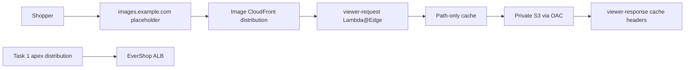

# Task 5 — CloudFront and Lambda@Edge image delivery

Status: **implemented and checked locally. Not deployed.** The image distribution is a separate CloudFront distribution from the Task 1 apex. `confirm_paid_deployment` stays false. No function was published, no distribution was created, and no DNS record was written.

| Class | Result |
| --- | --- |
| Implemented locally | Dedicated distribution, OAC, viewer-request validation, viewer-response cache headers, log bucket, alarms. |
| Locally tested | Node tests for path, encoding, methods, and query rules. Terraform fmt, validate, and a zero-change plan. An apex alias is rejected. |
| Simulated | The handler runs in Node on a CloudFront event shape. It does not run inside Lambda@Edge. |
| Not deployed | Every AWS resource in this stack. |
| AWS-unverified | A published version, a cache hit ratio, log delivery, and a real image response. |

## Architecture



`images.example.com` is a placeholder. The default alias list is empty, so a paid apply without aliases uses only the `*.cloudfront.net` name. This stack does not register a domain and does not create a Route 53 record.

Task 1 remains the only owner of the apex alias. This distribution has no ALB origin, does not forward cookies or `Authorization`, and does not attach the Task 1 web ACL.

## Request flow

1. The viewer requests `GET /products/{id}/{version}/{file}`.
2. The viewer-request function in `us-east-1`, replicated by Lambda@Edge, checks the method, the path, and the query string.
3. A valid path is rewritten to `/public/products/{id}/{version}/{file}`. That is the object key Task 6 already allows.
4. CloudFront caches that path. The cache key has no cookies, no headers, and no query string.
5. On a miss, Origin Access Control signs a `GetObject` to the private bucket. The origin request forwards nothing from the viewer except the key.
6. The viewer-response function sets `Cache-Control`. Versioned keys get `public, max-age=31536000, immutable`.

## Lambda@Edge trigger

Viewer-request is the gate. It runs before the cache lookup, so a rejected path is not stored and a rewritten key is what the cache remembers. An origin-request function would run only on a miss, after CloudFront had already built a cache key from the raw request.

Viewer-response sets the cache header on both hits and misses. Origin-response would skip hits.

`webp.js` is not associated. It can plan a conversion and it refuses a body at or above 1 MB, but the published handler returns `encoder-not-in-package`. Lambda@Edge is the wrong place for a native encoder: the viewer limit is 128 MB and 5 seconds, and an origin-response body cannot exceed 1 MB. Product variants should be written into the bucket by Task 6, under a new version segment, not generated at the edge.

`signed-url.js` refuses to run as a handler. A private key must not be deployed in the function. CloudFront key groups would validate a signature if that control is added later. The request handler keeps `Expires`, `Signature`, `Key-Pair-Id`, and `Policy` so it does not strip them, and the cache policy does not include them.

Both associated functions are `nodejs20.x`, 128 MB, 5 seconds, `publish = true`, and created by the `us-east-1` provider. `$LATEST` cannot be associated. The distribution uses `qualified_arn`.

## Security

The handler allows `GET` and `HEAD` only. The path must be `/products/{id}/{version}/{filename}` with `jpg`, `jpeg`, `png`, or `webp`. `avif` and `svg` are rejected. `avif` is not in the origin processing path.

Rejected before the cache:

- `..`, including a path that would normalize back inside the tree
- a single encoding of `..` or a null byte
- a second encoding layer
- a broken percent escape
- a raw null, a backslash, or a newline
- a path longer than 512 characters
- `origin`, `bucket`, `url`, `host`, or `uri` query parameters
- `w` or `h` outside `64, 128, 256, 512, 1024`
- `format` outside the four extensions
- `q` outside `60, 75, 80, 90`

A valid `w`, `h`, `format`, or `q` is removed from the query string. There is no encoder, so those values must not create extra cache entries. Unknown parameters such as campaign tags are dropped. The function never reads a bucket name or an origin hostname from the request.

The execution role trusts `lambda.amazonaws.com` and `edgelambda.amazonaws.com`. Its policy can create and write only the two image-function log groups. The region in the ARN is a wildcard because Lambda@Edge writes the log in the region where the request ran. The role cannot read Secrets Manager, the Task 2 MySQL secret, the EverShop password, S3, ECS, or EC2. There is no `Resource: "*"`.

The log-delivery ACL uses the published CloudFront log-delivery canonical user. That identifier is not an account secret. The bucket blocks public access, encrypts with AES256, and denies non-TLS.

`lambda:GetFunction` is granted to `edgelambda.amazonaws.com` on the published version. The permission does not also name the distribution ARN, because that reference would cycle with the distribution. The principal is the edge service, not the public.

## Cache strategy

| Setting | Value | Reason |
| --- | --- | --- |
| Object name | `/public/products/{id}/{version}/{file}` | A new picture is a new key. Invalidation is not the release mechanism. |
| Viewer TTL | `max-age=31536000, immutable` on that shape | Browsers can keep the bytes for a year. |
| CloudFront min / default / max | 0 / 86400 / 31536000 | `max_ttl` above one year is rejected. |
| Cache key | URI path only | Cookies, `Authorization`, `Accept`, and query strings are excluded. |
| Compression | Enabled | CloudFront still skips types it does not compress. JPEG and PNG are already compressed. |
| Error cache | 10 seconds for origin 403 and 404 | A missing key is not stored for a day. |
| Invalidation | Not the primary path | The first 1,000 paths in a month are free. Further paths are about $0.005 each. |

Cache poisoning is limited because the viewer cannot add a header, a cookie, or a query parameter to the key, and cannot choose the origin. Two sizes of the same picture are two objects in the bucket, not two query strings.

## Terraform

Stack: `infrastructure/terraform/task-5-cloudfront-edge`. The provider region is `us-east-1` because Lambda@Edge versions must be published there. The S3 origin domain still points at `ap-south-1`.

| Name | Default | Rule |
| --- | --- | --- |
| `confirm_paid_deployment` | `false` | Nothing is created until this is set on an approved apply. |
| `image_bucket_regional_domain` | `replace-with-task-6-bucket.s3.ap-south-1.amazonaws.com` | Must be a regional S3 domain. The placeholder is rejected on apply. |
| `apex_domain` | `example.invalid` | Rejected if it appears in `image_aliases`. |
| `image_aliases` | `[]` | Every name must start with `images.`. |
| `certificate_arn` | empty | Required, in `us-east-1`, when any alias is set. A zero account id is rejected. |
| `price_class` | `PriceClass_200` | Includes Asia. `PriceClass_100` does not include Mumbai. |
| `ipv6_enabled` | `true` | Configurable. |
| `max_ttl` | `31536000` | Must be from 1 day to 1 year. |

Outputs: `image_distribution_arn`, `image_distribution_domain`, `image_request_version_arn`. Pass the ARN to Task 6. Do not pass the Task 1 distribution.

## Deployment prerequisites

- A reviewed decision to set `confirm_paid_deployment`.
- The Task 6 bucket already created, and its regional domain supplied here.
- After this distribution exists, Task 6 `cloudfront_distribution_arn` set to `image_distribution_arn`.
- A certificate in `us-east-1` only if `image_aliases` is not empty.
- DNS for `images.…` created later, in a zone you already control. This stack does not create it.
- Real credentials. Local plans use inert keys and do not call STS.

No hostname is attached by default. `images.example.com` in this document is not a resource.

## Cost

Planning figures, not a bill. Confirm them on the CloudFront, Lambda@Edge, and S3 pricing pages before any apply. A quiet lab and a public catalog do not cost the same amount. AWS Budgets does not stop the spend.

| Component | Planning assumption |
| --- | --- |
| CloudFront HTTPS requests | About $0.01 to $0.012 per 10,000 requests. 100,000 requests are about $0.10 to $0.12. |
| Data transfer | About $0.085 to $0.12 per GB toward the internet for the early tiers. 10 GB is about $1 to $1.20. |
| Lambda@Edge requests | About $0.60 per million invocations. Viewer-request and viewer-response are two invocations. 100,000 image views are about $0.12. |
| Lambda@Edge duration | 128 MB and a short function. A few cents next to the request charge at lab volume. |
| S3 GET | About $0.0004 per 1,000 GETs, and only on a cache miss. |
| Standard logs | No separate CloudFront log charge. The private bucket expires objects after 14 days. |
| Invalidation | Avoid it. Paths after the monthly 1,000 are about $0.005 each. |
| WAF | Not attached here. A second web ACL would add the Task 1 monthly charge again. |
| Price class | `PriceClass_200`. `PriceClass_All` would add more edge regions and a higher transfer rate. |

A small test of 100,000 requests and 10 GB is on the order of $2 before GST. Ten million requests and 1 TB is on the order of $120 before GST, mostly data transfer. These are order-of-magnitude checks, not quotes.

## Cost risks

- Leaving the distribution enabled after the demo.
- A public alias with no cache, which turns every view into an S3 GET and two Lambda invocations.
- Associating `webp.js` later with a large package.
- Real-time logs, which this stack does not enable.
- A second WAF ACL.
- Using invalidation to publish new pictures instead of a new version segment.

## Testing

```bash
node --test application/edge-functions/edge.test.js
python3 scripts/run_validation.py
```

The Node file covers valid JPG, PNG, and WebP keys, nested product paths, a valid transform that is then removed, traversal, encoded traversal, double encoding, null bytes, a broken escape, a long path, a bad size, a bad format, an origin override, a bucket override, and `POST`. Docker was not used.

## Validation

Local Terraform for this stack: fmt, init with the backend disabled, validate, and a plan with no changes. A plan that sets `image_aliases` to `example.invalid` fails variable validation. The repository suite covers the other stacks as well. tfsec and checkov are not installed and were not run.

## Limitations

- The container image was not fetched, and this task does not serve EverShop HTML.
- No cache-hit ratio has been read from CloudFront. One local request is not a ratio.
- 403 and 404 responses are cached for 10 seconds and are not rewritten to a friendly page.
- The log bucket ACL is the legacy CloudFront delivery grant. It has not been accepted by a live account.
- Lambda@Edge logs use a region wildcard. That is the edge log path, not a general logs permission.
- Transform parameters are validated and discarded. They do not resize the picture.

## Integration with Tasks 1–4

Task 1 keeps the apex, both alias records, both web ACLs, and the storefront origin group. This stack does not edit that configuration.

Task 2 is untouched. The image role has no database action and no secret ARN.

Task 3 is untouched. No scaling policy or lifecycle hook changed.

Task 4 is untouched. The store still uses PostgreSQL, and the blue/green path is unchanged. The task role may still upload objects under the product-image bucket prefix; that is the Task 6 write path, not a read through this distribution.

## Handoff to Task 6

Task 6 owns the bucket, encryption, Block Public Access, versioning, lifecycle, inventory, and the upload scanner. This task does not create that bucket.

The bucket policy already allows `s3:GetObject` on `public/*` for one distribution ARN. Set that ARN to this stack's `image_distribution_arn`. Do not grant the Task 1 distribution.

Writers must store the public object at `public/products/{id}/{version}/{filename}` using lowercase `jpg`, `jpeg`, `png`, or `webp`. Replacing pixels means a new `{version}` segment. The viewer path omits `public`; the function adds it.

## Rollback

Disable this distribution or remove its alias. Do not delete or edit the Task 1 distribution as a rollback. A bad function is rolled back by associating the previous published version. `publish = true` leaves the prior version in the account until it is deleted. That association change has not been executed.

The log bucket and the functions have no `prevent_destroy`. Empty the log bucket before a destroy. The Task 6 bucket is outside this stack.

## Future deployment checklist

- [ ] `confirm_paid_deployment` reviewed and set only for that apply
- [ ] Task 6 bucket exists and the regional domain is not the placeholder
- [ ] Task 6 policy source ARN updated to this distribution after the first apply
- [ ] Alias list still starts with `images.` and does not include the apex
- [ ] `us-east-1` certificate present if an alias is set
- [ ] No DNS record created by this Terraform
- [ ] Function versions are numbered, not `$LATEST`
- [ ] Alarms exist and still have no notification topic
- [ ] A sample object under `public/products/...` returns 200, and a `..` path returns 400
- [ ] Cache statistics recorded from CloudFront, not from one request
- [ ] Distribution disabled and the log bucket emptied at the end of the lab
