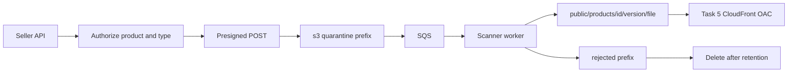

# Task 6 — Secure product-image storage

Status: **implemented and checked locally. Not deployed.** `confirm_paid_deployment` stays false. No bucket, queue, table, or function was created. No file was uploaded to S3. ClamAV was not installed and the scanner container was not built.

| Class | Result |
| --- | --- |
| Implemented locally | Private bucket design, presigned quarantine post, image checks, scan states, promotion rules, lifecycle, inventory, IAM. |
| Locally tested | Seller authorization, JPEG/PNG/WebP, MIME mismatch, a header that claims a huge PNG, EICAR, stale signatures, and the fail-closed worker. |
| Simulated | The fresh-signature engine is a test double. It is not ClamAV and it did not load a signature database. |
| Blocked | A ClamAV build, a signature update, and any live upload. Docker is not installed. |
| Not deployed | Every AWS resource in this stack. |
| AWS-unverified | Presigned POST against S3, a queue delivery, a scan, and a CloudFront read. |

## Architecture



One bucket holds the prefixes. A second bucket would isolate a bug in the policy, and it would also double the baseline and the replication work. The boundary here is IAM plus an explicit CloudFront deny on `quarantine/`, `rejected/`, `holding/`, and `incoming/`. CloudFront is allowed `s3:GetObject` only on `public/products/*`, and only when `AWS:SourceArn` is the Task 5 image distribution. The Task 1 apex distribution is not granted that read.

Objects are not public. ACLs are disabled with bucket-owner enforcement. Encryption is SSE-S3. A customer managed key was not added. The monthly key charge is not justified for this lab, and SSE-S3 still encrypts every object.

## Upload workflow

`POST /uploads` requires `X-CloudCart-Token`. The server resolves that token through an authorizer the application supplies. This repository does not add a password store. A missing token is 401. A seller who does not own the product is 403. An admin may upload for any valid product.

The body may contain `product_id`, `version`, `content_type`, and `content_length`. A caller-supplied bucket or key is ignored. The key is `quarantine/{upload_id}` with a 32-character hex id. The future public name is `image.jpg`, `image.png`, or `image.webp`. Product ids and versions must match the Task 5 pattern. `..`, SVG, and AVIF are rejected.

The URL is a presigned POST, not a PUT. The policy fixes the bucket, the key, and the content type, and it sets `content-length-range` from 32 bytes to 5 MiB. It expires in 120 seconds and never after 300. The browser does not receive an access key. The local signer uses a dummy endpoint at `127.0.0.1` and does not call S3.

The older `POST /presign/upload` helper still signs `incoming/` only. It is not the seller API. New uploads use `/uploads`.

State for a real apply is the DynamoDB table `cloudcart-image-uploads`, on demand, with a TTL attribute `expires_at`. The local tests keep that state in the grant object. Presigned URLs are not stored. Task 2 MySQL and the EverShop PostgreSQL database are not used.

## Scan and promotion

States are `PENDING`, `SCANNING`, `CLEAN`, `MALICIOUS`, `INVALID`, `ERROR`, and `EXPIRED`.

The worker packaged for Lambda is `security/malware/scan_worker.py`. Its engine matches the EICAR test string and has `can_clear = false`. A valid JPEG that is not EICAR stays `ERROR` with the public sentence "The file could not be scanned." It is not promoted. Setting `SCANNER_MODE` to anything else also returns no promotion, because ClamAV is not in the zip.

`FreshSignatureEngine` exists so tests can show the promotion gate. It is not selected by the worker. A CLEAN result from that double copies the logical object to:

`public/products/{product-id}/{version}/image.{jpg|png|webp}`

That is the key Task 5 requests after it rewrites `/products/{id}/{version}/{file}`. The copy is the scanned version id. A later event with a different version id does not reuse the old CLEAN result. The destination is refused if it already exists. A repeated event for the same version id returns the same decision. Content-Type is the detected type. `Cache-Control` is `public, max-age=31536000, immutable`. No ACL is set. S3 user metadata is only the product id and version. EXIF inside the file bytes is not rewritten. That strip is a later re-encode, and it is not claimed here.

MALICIOUS and INVALID objects are recorded under `rejected/{upload_id}`. ERROR does not publish and does not pretend the file was scanned. The uploader sees a short sentence, not the scanner log.

Image checks compare the declared type with the file header for JPEG, PNG, and WebP. Dimensions above 4096 pixels on a side, or above 16 million pixels, are rejected before a full decode. A PNG header that claims a 100000 by 100000 image is rejected. SVG is rejected.

## Lifecycle

| Prefix | Current objects | Older versions |
| --- | --- | --- |
| `quarantine/` | Delete after 1 day by default, at most 7. | Not archived. |
| `rejected/` | Delete after 7 days by default, at most 30. | Not archived. Malware is not sent to Glacier. |
| `public/products/` | Stay in S3 Standard while they are current. | Intelligent-Tiering after 30 days, Glacier Flexible Retrieval after 90 days. |

A current product image is not expired and is not transitioned. Replacing a picture is a new version segment, not an overwrite. Glacier Flexible Retrieval has a 90-day minimum storage duration, a restore that takes minutes to hours, and an early-deletion charge. Do not put the active catalog there. Intelligent-Tiering also has a monitoring charge per object. Both rules apply only to noncurrent versions.

## Inventory

The images bucket writes a weekly CSV inventory to a second private bucket, under `inventory/`. Fields are size, last modified, storage class, encryption, and ETag. Current versions are the included set. The inventory bucket does not inventory itself. Reports expire after 30 days. The delivery policy allows `s3.amazonaws.com` to write only that prefix, and only from this images bucket.

## IAM

| Role | Allowed |
| --- | --- |
| EverShop task | `GetObject` on `public/products/*`. `PutObject` on `quarantine/*` only. |
| Scanner | Read `quarantine/*`, write `rejected/*` and `public/products/*`, update the upload table, read the scan queue, write its log group. |

The scanner cannot read the MySQL secret, the EverShop password, or the whole bucket. The task role can no longer `PutObject` onto `public/`. Queue and table encryption use the service-owned keys, not a customer managed key.

## Monitoring

The dead-letter alarm fires when the DLQ has a visible message. It has no notification topic. Scanner logs are kept for 7 days. Logs must not contain the presigned policy, the token, or the file bytes.

The queue waits 180 seconds, keeps messages for 4 days, and moves a message to the DLQ after 3 receives. A duplicate S3 event for the same version is idempotent. A missing body, a timeout, and a stale signature database are ERROR.

## Cost

Planning figures in USD, before GST, for `ap-south-1`. Confirm them on the S3, Lambda, DynamoDB, and SQS pricing pages. They are not a bill. AWS Budgets does not stop the spend. CloudFront viewer traffic stays in the Task 5 estimate. S3 to CloudFront origin fetches are not counted again as internet transfer. SSE-S3 and SQS-managed encryption have no key charge.

| Scenario | Assumption | Planning total |
| --- | --- | --- |
| Demo | 1,000 images at 200 KB, 1,000 uploads, one scan each | Under $1. Storage is about $0.01. Requests and Lambda are cents. |
| Course project | 50,000 images at 500 KB, 5,000 uploads in a month | Under $5. About 25 GB of Standard storage is under $1. The queue, table, and scans stay small. |
| Busy catalog | 5 million stored images at 400 KB and 1 million uploads in a month | On the order of $70 before CloudFront. About 2 TB of Standard storage is the large line, near $50 at $0.025 per GB-month. A million 512 MB-second scans are under $10. PUT, DynamoDB writes, and SQS are a few dollars. |

Glacier is cheaper per GB and is a poor place for an image that is still on a product page. The 90-day minimum and the restore time are the operational risk. Inventory at weekly frequency is about $0.0025 per 1,000 objects listed. Five million objects are on the order of $12 a week if that rate holds, so a busy catalog should keep the weekly schedule and the 30-day report expiry, and should not add a daily inventory without looking at that line again.

## Deployment prerequisites

- A reviewed decision to set `confirm_paid_deployment`.
- A bucket name that does not end in `-example`.
- The Task 5 `image_distribution_arn`. The zero account id is rejected. Do not pass the Task 1 distribution.
- After the bucket exists, set Task 5 `image_bucket_regional_domain` to this bucket's regional domain.
- An application authorizer in front of `/uploads`. The token map in tests is not that system.
- A decision to keep the EICAR worker, or a separate approved build of ClamAV 1.4.1. The Dockerfile in `security/malware/Dockerfile` was not built.

## Rollback

Empty nothing in a hurry. The product bucket has `prevent_destroy`. To roll back a bad promotion, publish a new version segment and stop linking the bad key. Do not delete the current object as the first step, and do not expire `public/products/` to undo one file. A bad worker is reverted by deploying the previous Lambda zip. The DLQ holds the messages that failed three times. This rollback was not executed in AWS.

## Troubleshooting

| What you see | What it means |
| --- | --- |
| 401 on `/uploads` | The token was missing or the authorizer returned no principal. |
| 403 | The seller does not own that product. |
| Upload URL points at `public/` | That is not this API. `/uploads` only returns `quarantine/`. |
| Object stays out of `public/products/` | The packaged worker cannot clear a file. A fresh engine is required, and it is not deployed. |
| EICAR file | `MALICIOUS`, rejected prefix, not CloudFront. |
| DLQ alarm | The scan failed three times. The object was not promoted. |
| Current image moved to Glacier | The lifecycle in this stack does not do that. A current key stays in Standard. |

## Limitations

- The default engine does not detect malware other than the EICAR test string.
- A CLEAN promotion was exercised only with the test double.
- EXIF inside the image bytes is not stripped.
- Object Lambda is not used. New customers cannot start that feature, and thumbnails are not a substitute for it.
- The legacy EICAR module `security/malware/handler.py` still cannot publish. The worker is the path this stack packages.
- Docker and a live S3 call were not available, so neither is claimed.

## Security review

The browser cannot choose the bucket, the origin, or the key. Public ACLs are denied. CloudFront cannot read the quarantine or rejected prefixes. Only a CLEAN decision from an engine that is allowed to clear, for the same S3 version, can name a public product key. The packaged function is not such an engine. That is intentional until a pinned scanner with a fresh database exists.

## Validation

```bash
python3 -m unittest tests.unit.test_image_pipeline tests.unit.test_images_and_presign tests.security.test_policies_and_secrets
python3 scripts/run_validation.py
```

Terraform fmt, init with the backend disabled, validate, and a zero-change plan are part of the suite. A distribution ARN that uses the account id `000000000000` fails variable validation.
